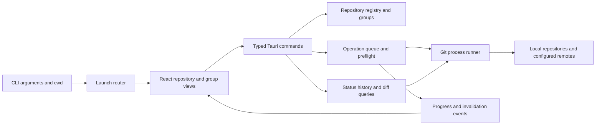

# Architecture

## Stack recommendation

Tauri/Rust/TypeScript is confirmed by the user. Use Tauri 2 for desktop integration, Rust for Git/process/storage services, and the proposed React + TypeScript + Vite UI. Use pnpm with a committed lockfile. Start with CSS variables and small accessible components; select a maintained list virtualization package during scaffolding. Keep the DAG algorithm as a pure TypeScript module with SVG rendering per row.

Tauri supports the target desktop platforms and uses their native webviews, avoiding a bundled browser engine. This favors distribution size; it does not prove lower memory use for this application. Keep the agreed stack through the build. See [Tauri overview](https://tauri.app/start/).

Development requires Rust and OS-specific dependencies: Apple development tools, Windows C++ tools/WebView2, or Linux WebKitGTK and related libraries. Establish builds separately on each OS. See [Tauri prerequisites](https://v2.tauri.app/start/prerequisites/).

## Boundaries



The renderer never constructs shell commands. Rust validates repository IDs, path tokens, refs, and operation preconditions. No general-purpose shell or filesystem IPC endpoint. Configure capabilities only for the dialogs and application behavior actually needed. Keep repository text escaped and external diff tools disabled in internal previews.

## Proposed layout and ownership boundaries

```text
src/
  app/                     # coordinator: shell, navigation, theme, launch intake
  api/                     # coordinator: TypeScript wire types and invoke wrappers
  components/              # coordinator: shared controls, diff, activity UI
  features/repository/     # repository UI worker
  features/groups/         # groups UI worker
  graph/                   # repository UI worker: layout + virtualized rendering
  test/fixtures/           # coordinator: shared wire fixtures
src-tauri/
  src/lib.rs               # coordinator: registration and integration
  src/launch.rs            # coordinator: CLI and forwarded launch requests
  src/contracts.rs         # coordinator: Rust wire contracts
  src/catalog/             # coordinator: registry, discovery, persistence
  src/operations/          # coordinator: batch scheduling and events
  src/git/                 # backend worker: runner, reads, mutations, locks
  tests/                   # backend worker: real Git fixtures and integration tests
docs/                      # plan and implementation handoff
.github/workflows/         # coordinator: native platform checks
```

This is a target layout, not an existing implementation. Scaffold it before delegating writes. The coordinator owns dependency manifests, lockfiles, registrations, shared contracts, and shared components. Workers request shared changes rather than editing those files concurrently.

## Git and operation service

Use installed Git, discovered at startup and overridable by an explicit executable path in settings. Do not assume GUI PATH matches terminal PATH, or a Windows Git install lives in one fixed location. Report executable and version in diagnostics. Establish a minimum supported Git version during the first fixture run; proposed floor is 2.39, with CI verification rather than relying on the newest online docs.

Keep domain logic testable without starting Tauri. Use asynchronous processes; bound reads and network jobs independently. One mutation lock per canonical shared Git directory also covers linked worktrees. Reads get generation tags; discard a stale read result after a mutation. External Git clients remain outside the lock, so refresh and reject stale preconditions.

Initial limits: four status reads, three network operations, one mutation per shared repository. All write operations, including fetch, use the shared-repository lock. Batch fetch can coalesce identical remote fetches for linked worktrees; do not coalesce entries whose resolved remote configurations differ. Keep a result for each requested member.

For M1, queued jobs are cancelable. Running writes may report “cancel requested” and finish at a safe boundary; do not require forced process termination to ship. Add process-tree cancellation only with platform tests. Every completion, failure, interruption, and cancel request eventually triggers status/ref invalidation.

## History and DAG

Snapshot HEAD and selected local/remote/tag tip OIDs. Exclude stash and application backup refs from default history. Read commits in topological order against those immutable roots, in pages of 200. Maintain a backend snapshot ID and opaque cursor. Refs changing outside the app cause a refresh, never pages silently drawn from different snapshots.

Use commit OIDs and ordered parent OIDs to assign lanes deterministically. At each row, find/create the commit lane, route the first parent through the continuing lane where possible, allocate or connect additional parents, then retire unneeded lanes. Preserve pending-parent lanes between pages. Boundary parents remain visible as continuation endpoints. Test graph invariants, merges, crossing lanes, and paging continuity independently from the renderer.

Keep ordering/layout state for loaded pages. Render visible rows with SVG and text; avoid one huge canvas or DOM containing every commit. Display refs separately from raw commit objects so refresh can update badges. Branch filtering establishes a new history snapshot. Search, when added, must not fabricate direct edges across excluded commits.

The first implementation may use offset traversal against fixed root OIDs; record its large-history cost. A retained incremental walk or cached ordered OID index is the follow-up if measured paging latency exceeds budgets. Do not retain an unbounded history walk for every group member.

## State, refresh, and persistence

Repository identity is the canonical worktree root plus its Git metadata identity; shared-lock identity is the canonical common Git directory. Preserve original native paths in Rust; wire display strings are not action targets. Resolve aliases and duplicate paths to one entry while keeping distinct worktrees separate. Reject bare repositories clearly in M1.

Project files are the source of truth for group names and membership; see [the project format](PROJECT_FILES.md). Resolve relative member paths against the project file's directory. Store only machine preferences, recent project/repository paths, chosen Git executable, and UI preferences in a versioned settings document in the OS application data directory. Preserve native path round-trip when serializing private settings. The sole app process owns settings writes; use temporary file plus platform-correct atomic replacement, retain a last-good backup, and surface corrupt data without overwriting it. Before editing a project file, compare its on-disk revision with the opened revision and require reload if changed externally.

Draft commit messages are per-repository state; preserve them across navigation. Cross-restart draft persistence is optional and must be documented if implemented. Operation results are bounded in memory for M1; user-triggered export redacts URL credentials. No repository file contents or credentials in settings.

On startup, the backend queues a launch request until the UI subscribes and acknowledges receipt. Subsequent launches pass both argv and original cwd through the single-instance handler. Tauri's plugin exposes these inputs; register it first. See [single-instance documentation](https://v2.tauri.app/plugin/single-instance/).

## Distribution and verification

Produce a local macOS `.app` and launcher first. Configure native CI for macOS, Windows, and Linux, initially generating unsigned development artifacts: macOS bundle/DMG, Windows installer, and Linux AppImage or Debian package. Validate the chosen Linux artifact on its target environment. Do not imply signed distribution or notarization without credentials and actual checks. See [Tauri distribution guidance](https://v2.tauri.app/distribute/).

Use backend integration tests with real temporary Git repositories and renderer tests with typed fixtures. Browser tests against mocked IPC verify UI behavior, not native integration. Include a native app smoke pass. Tauri's current guide describes an embedded WebDriver service across all three OSes; the direct native `tauri-driver` path has different platform support. Evaluate this after a working local build, and keep test driver plugins out of release builds. See [Tauri testing](https://v2.tauri.app/develop/tests/webdriver/).
